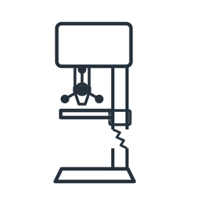
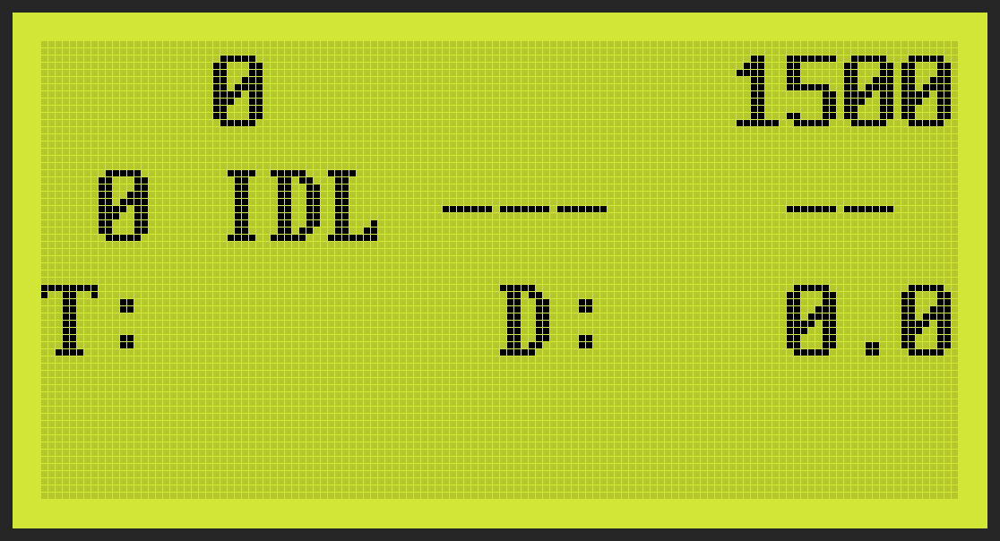
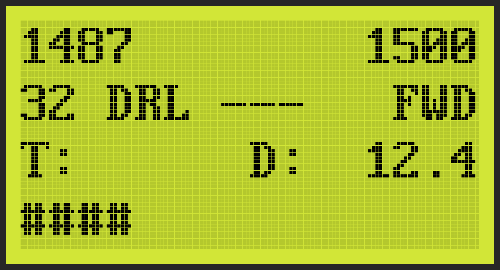
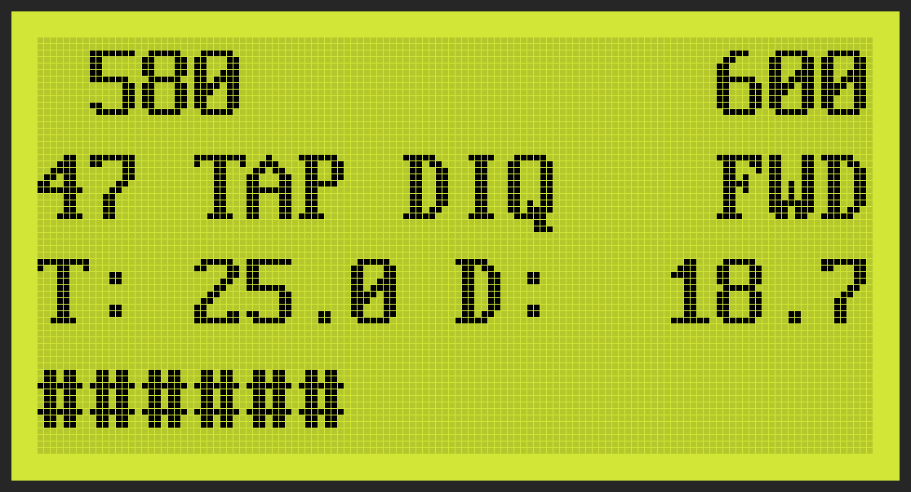
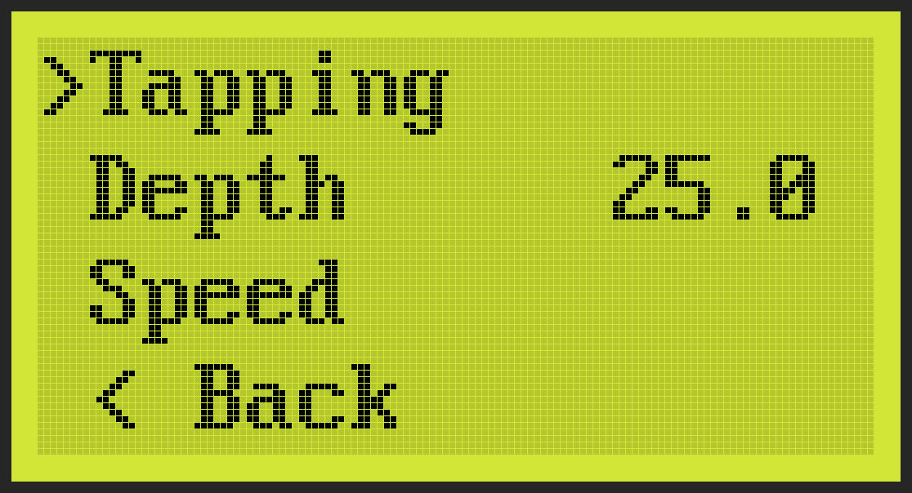
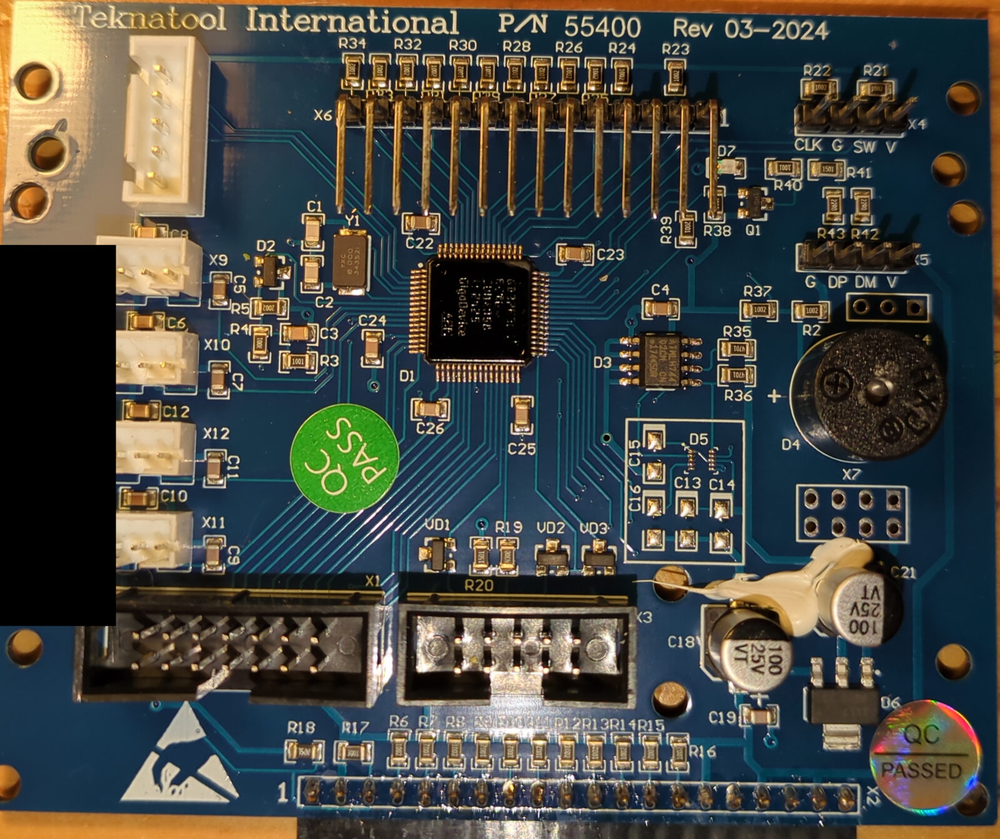

<p align="center">
  <picture>
    <source media="(prefers-color-scheme: dark)" srcset="docs/branding/nv-logo-dark-1024.png">
    
  </picture>
</p>

<h1 align="center">Nova Voyager Open Firmware</h1>

<p align="center">
  Open-source replacement firmware for the <b>Teknatool Nova Voyager DVR</b>
  drill press HMI controller<br>
  <sub>GD32F303RCT6 · ST7920 16×4 LCD · FreeRTOS</sub>
</p>

---

<table>
<tr>
<td></td>
<td></td>
</tr>
<tr>
<td align="center"><sub>Idle — target 1500 RPM, load bar empty</sub></td>
<td align="center"><sub>Drilling at 1487 RPM, 32% load, 12.4 mm depth</sub></td>
</tr>
<tr>
<td></td>
<td></td>
</tr>
<tr>
<td align="center"><sub>Tapping at 580 RPM with Depth+LoadInc+Quill triggers</sub></td>
<td align="center"><sub>Menu navigation (wraps at top/bottom)</sub></td>
</tr>
</table>

<p align="center">
  
  <br>
  <sub>The HMI board this firmware runs on — Teknatool P/N 55400 Rev 03-2024.
  GD32F303RCT6 centre, AT24C02 settings EEPROM to its right, SWD on the
  <code>X4</code> header (<code>CLK G SW V</code>) top-right.
  More in <a href="docs/HARDWARE_SETUP.md">docs/HARDWARE_SETUP.md</a>.</sub>
</p>

> Community-developed firmware based on reverse engineering.
> Installing this replaces the OEM firmware. Back up your OEM image
> first — see [`docs/HARDWARE_SETUP.md`](docs/HARDWARE_SETUP.md).

---

## What this adds

- **Tapping** — 6 combinable triggers (depth, load increase, load slip,
  clutch, quill direction, peck) with GF bit 2 direction-change polling
- **Foot pedal** — uses the unused X11 connector on the HMI board for
  hands-free chip-break and reverse override
- **Load bar** — ST7920 CGRAM bar graph on row 3 (40-step, 16x16 custom chars)
- **F4 display modes** — load bar / temperature + DC bus voltage / speed info / off
- **Material speed calculator** — 12 materials, 9 bit types, auto RPM
- **Configurable motor** — overload threshold (LD), speed ramp (DN),
  max speed, advanced PID submenu, motor profiles (Soft/Normal/Hard)
- **OEM-compatible EEPROM** — speed presets and max RPM survive firmware
  switches; custom settings in 0xB0-0xFF; crash dump persists across power cycles
- **Step drilling** — automatic RPM adjustment by tool diameter
- **Favorite speeds** — F1 cycles presets, long-press saves current RPM
- **Sensor alignment** — ALIGN command tests RPS phases via voltage hold
- **F0 fault decoding** — motor error screen shows decoded MCB fault code
- **Settings export** — DUMP (all settings) + EEDUMP (EEPROM hex dump)
- **Games** — optional Pong, Snake, Penguin in a separate FreeRTOS task
  (`pio run -e nova_voyager_games`); zero game code in default build
- **Serial console** — 121 commands, 72 of them in release builds (9600 baud)
- **USB DFU updates** — with the **72 MHz** companion
  [bootloader](https://github.com/Packerlschupfer/nova-voyager_bootloader),
  no ST-Link needed for subsequent flashes. Note the pairing: the default
  `nova_voyager` build runs at 120 MHz, and the 120 MHz bootloader cannot
  derive the 48 MHz clock USB needs, so it refuses DFU — `DFU` on that pairing
  just reboots, and the firmware says so when you try. Build and flash the
  72 MHz pair (`./flash_firmware.sh custom --dfu`) if you want USB updates;
  otherwise every flash needs SWD.
- **Documented MCB protocol** — see [`docs/MOTOR_PROTOCOL.md`](docs/MOTOR_PROTOCOL.md)
  and [`docs/EEPROM_MAP.md`](docs/EEPROM_MAP.md)

---

## Quick start

```bash
# Build (production, no games)
pio run -e nova_voyager

# Build with games (Pong, Snake, Penguin)
pio run -e nova_voyager_games

# Flash via ST-Link (fast — assumes flash already unlocked)
./flash_firmware.sh quick

# First-time install (unlocks flash protection, writes bootloader + app)
./flash_firmware.sh custom

# Restore OEM firmware
./flash_firmware.sh original
```

For bench setup, wiring, and first-flash instructions see
[`docs/HARDWARE_SETUP.md`](docs/HARDWARE_SETUP.md).

---

## Hardware

| | |
|---|---|
| MCU | GD32F303RCT6 (ARM Cortex-M4F, 120 MHz, 256 KB flash, 48 KB RAM) |
| Display | ST7920 16x4 character LCD, 8-bit parallel |
| Motor link | USART3 @ 9600 baud to MCB (Switched Reluctance Motor controller) |
| Inputs | Rotary encoder + 7 buttons (EXTI), foot pedal |
| Sensors | Depth (ADC), guard switch, E-Stop |
| Bootloader | DFU at `0x08000000` (12 KB), application at `0x08003000` (242 KB + a 2 KB settings page) |

### Back up your settings before erasing anything

```bash
./scripts/nova-settings.sh export my-machine.txt    # before
./scripts/nova-settings.sh import my-machine.txt    # after
./scripts/nova-settings.sh diff   my-machine.txt    # compare
```

`EXPORT` on the console emits the settings **as `SET` commands** — the output
is the restore procedure, so it goes through the same validated setters as a
human typing them, with no separate format and no blob that could bypass a
range check.

Worth doing before `custom`, `erase`, `quickboot` or `original`: all four erase
flash, which takes the settings page at `0x0803F800` with it. Only `quick`
leaves it alone. The external EEPROM is a separate chip and survives, but it is
61 bytes and cannot hold everything — material, bit type, diameter,
`interface.*` and display units live only in the flash mirror and are lost.

The import replays one line at a time, checks every reply, and refuses to
`SAVE` if any setting failed or was clamped. A partial restore that reports
success is the specific failure this is built to prevent.

Not yet covered by `EXPORT`: `depth.*`, `step_drill.*`, the tapping timings,
`interface.*` and `display.units` — no `SET` keys exist for those yet, and
`EXPORT` says so in its own output rather than leaving you to notice.

### Bootloader pairing

Verified against the bootloader source on 2026-10-31, because guessing at this
is how panels get bricked:

- **The app cannot tell which bootloader is installed.** There is no version
  word at a fixed address and no handshake; the firmware can only infer from
  its own clock, which is a heuristic. The `DFU` command says so rather than
  pretending otherwise.
- **The bootloader does not validate the application** beyond two range
  checks — the initial stack pointer at `0x08003000` must land inside SRAM, and
  the reset vector inside the app region. No CRC, no signature. An erased app
  fails those checks, which is how the board falls back into DFU.
- **A DFU update cannot erase your settings.** The reserved page at
  `0x0803F800` is refused structurally: every write and erase goes through an
  address check, a bare mass-erase request is refused, and the descriptor
  advertises 121 sectors rather than 122. There are host-side tests for all
  three.
- **An ST-Link write can.** `st-flash` goes through none of that — a full-chip
  erase (`./flash_firmware.sh erase`) or an image longer than 242 KB takes the
  settings page with it. Back up your EEPROM first.
- The DFU request word is cleared by the bootloader as soon as it reads it, so
  a request cannot get stuck across a reset.

#### One unproven caveat, if you choose the DFU pairing

A single flash cell at `0x08000488` — inside the bootloader's first page — has
gone bad six times on the author's board: a 0→1 bit flip, repaired by a rewrite
every time. The cause is not established. The current working hypothesis is a
weak cell on this particular part; an earlier theory that it was a debugger
misread has been ruled out. It correlates with flash programming in general
rather than with DFU specifically.

Why it matters to the choice above: the **120 MHz** bootloader is 792 bytes, so
that address is erased flash and a flip there cannot affect execution. The
**72 MHz DFU** bootloader is 3540 bytes and does place code over it. So if the
defect is specific to this board, none of this concerns you; if it is a
weakness that comes with the part, the DFU pairing is the one that would be
exposed. Nobody knows which, and with one board there is no way to know.

Stated here rather than omitted because the honest summary is "one board, six
incidents, cause unknown" — not a reason to avoid the DFU pairing, and not
something to discover on your own machine either.

### Pin map

| Signal | Pin | Notes |
|--------|-----|-------|
| LCD data bus | PA0-PA7 | 8-bit parallel |
| LCD RS / RW / E | PB0 / PB1 / PB2 | Control lines |
| Encoder A / B / Btn | PC13 / PC14 / PC15 | 4 counts/detent, button = fine/coarse toggle |
| E-Stop | PC0 | Active high, direct GPIO cutoff path |
| Guard switch | PC2 | Active high (open = high) |
| Foot pedal | PC3 | Active low (X11 connector) |
| Depth ADC | PC1 | ADC1 channel 11 |
| Motor UART | PB10 / PB11 | TX / RX |
| Debug UART | PA9 / PA10 | TX / RX, 9600 baud |

---

## LCD layout

```
1487        1500     <- actual RPM (left), target RPM (right)
32 DRL ---   FWD     <- load, state, triggers, direction
T:      D:  12.4     <- target depth, current depth
[||||||||         ]  <- load bar (F4 cycles: load / temp / speed / off)
```

State codes: `IDL` idle, `DRL` drilling, `TAP` tapping, `STP` step drill, `MNU` menu.

### F-keys

| Key | Short press | Long press |
|-----|-------------|------------|
| F1 | Cycle favorite speeds | Save current RPM to favorites |
| F2 | Arm / disarm tapping | — |
| F3 | Set depth target to current depth | — |
| F4 | Cycle row 3 (load bar / temperature / speed info / off) | — |

---

## Tapping

Six **combinable** triggers. Enable any subset in the menu; arm with F2.

| Code | Trigger | Watches | Use case |
|:----:|---------|---------|----------|
| `D` | Depth | Quill depth sensor | Stop / reverse at target depth |
| `I` | Load Inc | KR (load %) spike | Blind holes, excessive resistance |
| `S` | Load Slip | CV overshoot | Through-hole exit detection |
| `C` | Clutch | Load plateau | Torque limiter engaged |
| `Q` | Quill | Quill direction change | Auto-reverse on quill lift |
| `K` | Peck | Timed cycles | Chip clearance |
| `P` | Pedal | Foot pedal | Manual chip-break / hold |

Priority: **Pedal > Quill > Depth > Load > Peck**.

---

## Foot pedal (optional)

The HMI board exposes PC3 on the **X11** connector. The OEM firmware
doesn't use it; this firmware reads it as a foot-pedal input.

| Part | Spec |
|------|------|
| Foot switch | TFS-1 momentary SPST, NO contacts |
| Panel jack | GX12 2-pin, panel-mounted |
| Internal cable | JST PH 2.54mm 3-pin to X11 |

```
  foot switch          chassis panel jack          HMI board X11
   ┌─────┐               ┌─────────┐               ┌──────────┐
   │TFS-1│──── 2 wire ───┤  GX12   ├──── 2 wire ───┤ PC3 sig  │
   │ NO  │               │  2-pin  │               │ GND      │
   └─────┘               └─────────┘               │ N/C      │
                                                    └──────────┘
```

Active low, internal pull-up. Disable in `Menu > Tapping > Pedal`
if wired but not wanted for a session.

---

## Architecture

5 FreeRTOS tasks (+ 1 dynamic game task when games are active):

| Task | Prio | Stack | Rate | Role |
|------|:---:|:-----:|:---:|------|
| Main | 1 | 256 W | ~100 Hz | Event queue, console, watchdog |
| Depth | 2 | 96 W | 50 Hz | ADC quill sensor |
| UI | 2 | 256 W | 50 Hz | Buttons, encoder, LCD |
| Tapping | 3 | 160 W | 20 Hz | Trigger state machine |
| Motor | 4 | 192 W | 2/20 Hz | UART to MCB (adaptive) |

Per-task heartbeat watchdog: the main loop feeds the IWDG only when
all tasks have checked in and the event queue is draining. A task that blocks
longer than `HEARTBEAT_TIMEOUT_MS` (2 s) triggers a console alarm; a *reset*
needs the IWDG to expire on top of that, roughly 7 s of contiguous blocking.
Long UI waits use `delay_ms_ui()`, which beats the heartbeat while it waits. HAL tick
kept in sync via `vApplicationTickHook()` → `HAL_IncTick()`.

Motor stack:

```
task_motor.c           FreeRTOS task, command queue, status polling
  +- motor.c           MCB parameter API (profile, PID, power)
  +- motor_protocol.c  Packet build / parse
  +- motor_uart.c      USART3 hardware (polled RXNE — see below)
```

`USE_USART3_DMA` exists but is **not defined**, so RX is a bare `RXNE` poll with
no buffering: a byte survives one character time, ~1.04 ms at 9600 baud. Any
reader that sleeps between polls overruns after the first byte — which is
exactly what `motor_read_param()` did (`delay_ms(2)`), and why every console
parameter read returned -1 until it was rewritten to poll tightly and stop at
ETX, the way `task_motor.c::wait_response()` always had.

---

## Safety

- **E-Stop** — ISR drives PD4 low (motor enable) before any queued
  command. Cannot be delayed by a stuck task, full queue, or UART failure.
- **Guard interlock** — motor refuses to start with guard open;
  auto-stops and activates spindle hold if guard opens while running.
- **Single start gate** — every path that energizes the spindle goes
  through `safety_can_start_motor()` (`include/safety.h`). Nothing in C
  enforces that, so `scripts/check-safety-gate.sh` does: it fails the
  build if a function drives the motor-enable line without consulting the
  gate. Added after review found the console `ALIGN` command bypassing it.
  The gate also refuses while an MCB parameter write is in progress, because
  that suspends the poll loop the jam detectors live in.
- **MCB writes are exclusive** — syncing parameters to the motor controller
  pauses the status poll, which also suspends all four jam detectors. Those
  commands (`MSYNC`, `MSAVE`, `MREAD`, menu Save/Reset) therefore claim an
  envelope that refuses while the machine is drilling or tapping, and refuse
  each other rather than tearing down an active write.
- **Edge-latched interlocks** — the guard and E-Stop handlers act on the edge
  latched by the ISR, not on the pin level at the moment the event is
  processed. A guard bumped open and shut before the event is dequeued still
  stops and brakes the spindle.
- **Queue purge** — E-Stop, guard open, and motor fault purge the motor
  command queue to prevent stale FORWARD/REVERSE from re-enabling the motor.
- **Watchdog** — IWDG ~3 s, fed only when all 5 tasks are alive and the
  event queue is draining. Queue saturation = stall = reset.
- **EEPROM settings** — when EEPROM is present, no flash writes needed
  (no 20ms CPU stall, safe to save while motor running).
- **Last-used speed remembered** — the spindle speed is written to EEPROM once
  the encoder has been still for 5 s and the value differs from what is stored,
  so pressing OFF (wired to NRST) no longer loses it. Two bytes per adjustment,
  not one write per detent; matches the original firmware's behaviour.
- **COMM FAULT** — 15 consecutive UART failures trigger hardware motor
  disable + fault state with F0 code decoding.
- **USART overrun handling** — on the MCB link, ORE and RXNE are reported
  together and the pending byte is returned rather than discarded. The old
  recovery read `DR` purely to clear the flag, throwing away a valid unread
  byte, and then reported availability from a stale status snapshot.
- **Depth target** — auto-stop and beep when quill reaches target depth
  or step drill reaches target diameter.

---

## Serial console

9600 baud on PA9/PA10. 72 commands in a release build (121 counting the
debug-only ones) — start with `HELP`, which generates its list from the command
table, so it cannot go stale the way this paragraph can.

| Command | What it does |
|---------|--------------|
| `STATUS` | System state, queues, overflow counters |
| `STACK` | Per-task stack high-water marks |
| `DEPTH` | Live depth sensor |
| `GUARD` | Guard / pedal / E-Stop GPIO state |
| `KR` | Query MCB load percentage |
| `CV` | Query MCB current speed |
| `TAP` | Show / configure tapping triggers |
| `SPEED <rpm>` | Set target RPM |
| `DUMP` | Export all settings as key=value |
| `EEDUMP` | Hex dump HMI EEPROM (256 bytes) |
| `MREAD` | Read the nine MCB parameters back |
| `MSYNC` / `MSAVE` | Push settings to the MCB / persist them there |

`MSYNC`, `MSAVE` and `MREAD` refuse while the machine is drilling or tapping,
and refuse each other: each pauses the MCB status poll, and the jam, load-spike,
step and stall detectors all run inside that poll. A read-only diagnostic is not
worth blinding them mid-cut. Stop the spindle and repeat.

`SAVE` reports what actually happened — a save whose flash mirror had to be
deferred says so rather than claiming success.

| Command | Does |
|---------|------|
| `ALIGN [A/B/C/OFF]` | Sensor alignment test |
| `GAME P/S/N` | Pong / Snake / Penguin (games build only) |
| `DFU` | Reboot into USB DFU bootloader (see the note on bootloader pairing) |
| `SAVE` | Persist settings to EEPROM |

---

## Build gates

CI and the release workflow run five checks that encode invariants the
compiler and the test suite cannot. Before pushing, the whole routine is:

```bash
./scripts/check-builds.sh          # all four CI environments
pio test -e native                 # 506 tests
./scripts/check-safety-gate.sh
./scripts/check-settings-mirror.sh
./scripts/check-pins.sh
./scripts/check-version.sh
./scripts/check-settings-keys.sh
```

| Script | Enforces |
|--------|----------|
| `scripts/check-builds.sh` | Every environment CI builds, builds locally — and prints each one's RAM figure. Only `release` was ever built by hand, so a 1280-byte jam flight recorder overflowed the RAM-tight games and demo builds past the DFU hand-off word and left CI red for eight commits before anyone noticed. |
| `scripts/check-version.sh` | `FW_VERSION_MAJOR/MINOR/PATCH` and `FW_VERSION_FALLBACK` agree with each other, and with the tag being released. The version was hand-maintained once and said `v0.1.0-RTOS` for 35 commits. |
| `scripts/check-settings-keys.sh` | `DUMP`, `GET`, `SET` and `EXPORT` agree on the settings keys. There were three independent hand-maintained lists; `DUMP` printed 34 keys and `SET` could write 14, so a settings export could restore a third of a machine and report success doing it. |
| `scripts/check-pins.sh` | The toolchain/framework pins in `platformio.ini` are actually applied per-env — a pin declared only in `[common]` is silently ignored, which is how the first release binary differed from the tested one. |
| `scripts/check-safety-gate.sh` | Every function that drives the motor-enable line consults `safety_can_start_motor()`, or is on a two-entry allowlist with a reason. No test can see a gate that was never called. |
| `scripts/check-settings-mirror.sh` | `test/test_settings`'s local copy of the settings types matches the real headers. `pio test -e native` compiles no `src/`, so that mirror IS the coverage — when it drifts the suite passes while testing a layout the firmware does not ship. |

Each is negative-tested: breaking the invariant makes the script fail and name
the offending symbol.

## Project status

- All features implemented; firmware in daily use
- **513 unit tests** across 20 suites (all passing)

  Six of those suites exercise the *shipping* code rather than a copy, by
  keeping the logic in a header the tests can include directly — `safety.h`,
  `menu_format.h`, `settings_pack.h`, `events_policy.h`, `speed_autosave.h`,
  `voltage_monitor.h`.
  That matters because `pio test -e native` compiles no `src/`: a suite that
  re-implements the logic it is checking proves only the copy right, which is
  how a guard/E-Stop edge bug and 39 unpersisted settings survived a full
  green suite.
- 0 compiler warnings
- ~31% flash / ~28% RAM (production); ~34% / ~41% RAM with games

---

## License

Copyright (C) 2026 Packerlschupfer (https://github.com/Packerlschupfer)

GPL-3.0 — see [LICENSE](LICENSE). `LICENSE` is the bare licence text, which
names no holder; this is the notice the GPL's own "How to Apply" section asks
for, so that anyone redistributing a build knows whose copyright they hold it
under.

### Third-party code in a built binary

The firmware links components under their own licences. A binary redistributed
from this project carries all of them:

| Component | Licence | Where |
|-----------|---------|-------|
| FreeRTOS kernel | MIT | PlatformIO framework package |
| STM32Cube F1 HAL / CMSIS | BSD-3-Clause | PlatformIO framework package |
| Unity test framework | MIT | `pio test -e native` only — not in a firmware binary |
| `scripts/font8x16.py` | MIT (hubenchang0515) | build-time glyph generation |

No manufacturer code and no manufacturer binaries are present — see
*Trademarks and independence* below.

## Safety

This firmware replaces the controller that drives a **machine tool with a
powered spindle**. It participates in starting and stopping the motor and in
the guard and E-Stop paths.

- **Installing it is entirely at your own risk**, and will almost certainly
  void any manufacturer warranty and support.
- It is offered with **no warranty of any kind** — see sections 15 and 16 of
  the GPL. Nothing here is certified for safety-critical use, and no claim is
  made that it is as safe as the firmware it replaces.
- Keep the original firmware images and your EEPROM contents backed up before
  flashing. Restoring the OEM firmware is supported
  (`./flash_firmware.sh original`) but depends on you having those files.
- Never rely on software as your only protection. The physical guard, the
  E-Stop and unplugging the machine are what actually keep you safe.

## Trademarks and independence

**Teknatool**, **NOVA** and **Voyager** are trademarks of their respective
owners. This project is **not affiliated with, authorised by, endorsed by or
supported by Teknatool International** or any of its distributors. Those names
are used only to identify the hardware this firmware is compatible with.

This is a clean, independent implementation. It contains **no manufacturer code
and ships no manufacturer binaries.** Where the firmware has to interoperate
with the original hardware — the motor-controller serial protocol, the EEPROM
layout, the parameter registers — that interface was determined by independent
analysis and by logic-analyzer captures of the wire, and is documented here in
our own words as factual interface information.

If you are the rights holder and something here concerns you, please open an
issue.

## Credits

Reverse engineering based on independent analysis of the Teknatool
firmware (R2P05x, R2P06e, R2P06k), logic-analyzer captures of the MCB
protocol, and patient experimentation.
