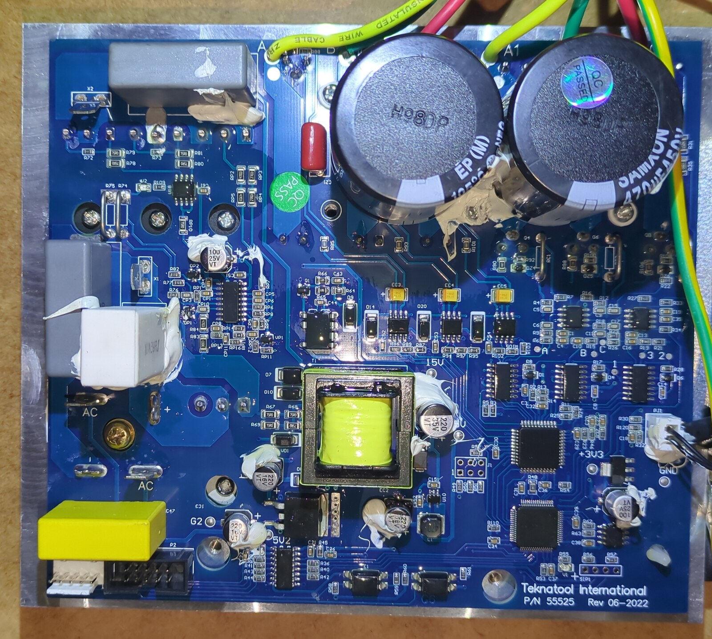
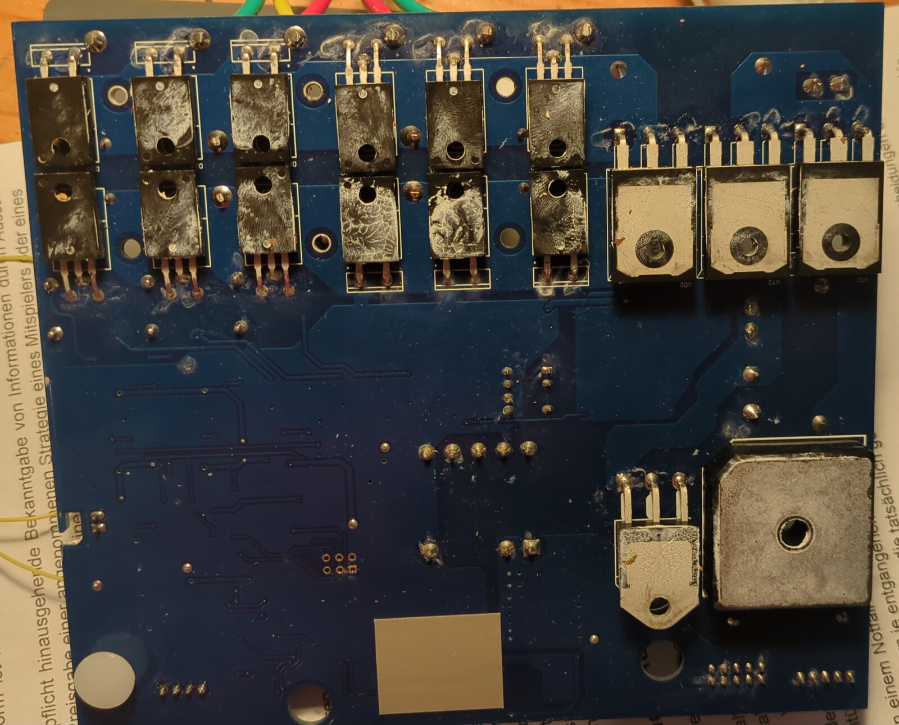

# MCB hardware reference

The *motor control board* (MCB) is the second PCB in the Nova Voyager drill
press — the HMI drives it over an isolated UART link, and it in turn runs the
spindle motor. This repo targets the HMI; the MCB has its own GD32 MCU and its
own firmware, which is **not published**. This doc captures the hardware
facts about the MCB that matter when you are developing or debugging HMI
firmware against a real machine.

> This is a companion to [HARDWARE_SETUP.md](HARDWARE_SETUP.md), which covers
> the HMI programmer/debugger bench setup. If you are only writing HMI
> firmware you may never need to open the MCB — but when the link to it
> misbehaves, having the MCB side mapped is what makes the problem tractable.

Source material: the MCB reverse-engineering notes live in a separate,
unpublished repo (`nova-voyager_mcb/MCB_REFERENCE.md`). What follows is the
hardware-only subset that is safe to publish.

---

## MCU

| Item | Value |
|------|-------|
| Part | GigaDevice **GD32F303RCT6** |
| Core | Cortex-M4 |
| Package | LQFP64 |
| Flash | 256 KB @ `0x08000000` |
| SRAM | 48 KB @ `0x20000000` |
| Max AHB | 72 MHz (HSE + PLL) |
| APB1 | 36 MHz |
| APB2 | 72 MHz |

Post-reset the chip is running on the internal 8 MHz HSI until firmware brings
up HSE and the PLL. This matches STM32F103 topology closely enough that
`openocd -f target/stm32f1x.cfg` drives the GD32F303 without complaint.

---

## SWD programming header `SIP1`

The MCB exposes SWD on an **unpopulated 4-pin 2.54 mm through-hole header**
along the board edge, below the `Teknatool International` silkscreen. The two
small resistors right next to it (`R56`, `R57`) are the SWDIO/SWCLK series
resistors.



*MCB top side. `SIP1` is the 4-hole footprint at lower right, silkscreen-labelled,
just below the two quad-flat packages. The HMI 10-pin box header and the 5-pin
RPS header are the pair at lower left. `G2`, `+3V3` and `GND` silkscreens are
legible at full size, as is `P/N 55525 Rev 06-2022` bottom right.*

<!-- PHOTO WANTED: photos/mcb-sip1-detail.jpg
     Straight-down macro, SIP1 centred, R56/R57 both in frame, the square pad
     clearly square. Oblique lighting makes the plated-hole annulus read.
     Caption when it lands: "The unpopulated 4-pin SWD header. Pin 1 is the
     square pad."
     Already tried and rejected: cropping this out of the 2026-09-06 bench
     overviews. At that magnification the four plated holes are ~20 px across
     and all four read identically - the square pad does not resolve, which is
     the single thing this slot exists for. It needs a dedicated macro. -->

**Pin 1 (square pad) → pin 4, as wired on this board:**

| SIP1 pin | Net   | GD32 pin |
|----------|-------|----------|
| 1        | 3V3   | —        |
| 2        | SWDIO | PA13 (package pin 46) |
| 3        | SWCLK | PA14 (package pin 49) |
| 4        | GND   | —        |

<!-- PHOTO WANTED: photos/mcb-sip1-wired.jpg  (highest value of the set)
     Probe leads in all four holes, straight-down macro, the square-pad pin
     visibly carrying the lead that goes to 3V3. Colour-coded leads (red to
     pin 1, black to pin 4) would make the convention obvious without reading
     any caption. This photo exists to settle "pin 1 is 3V3, not GND" - a wrong
     read there puts 3V3 into SWCLK - so it must actually SHOW that, or stay
     absent. Do not substitute a crop that merely implies it.
     Status: a candidate exists (2026-10-10 bench shot, header fitted to SIP1,
     leads red/yellow/white/black running from the R55/V1 end toward the board
     edge). It is held, not rejected: the fitted housing covers the pad
     markings, so the photo shows lead order but cannot show which hole is
     pin 1, and whether red is the 3V3 lead is this bench's convention rather
     than something the photo establishes. Land it once that is confirmed at
     the probe end, with a caption that says which end carries 3V3. -->

**No NRST on the header.** NRST is GD32F303 package pin 7 — if a connect-under-
reset flow is ever needed, tack a wire directly to the pad. For normal flashing
and interactive debugging, hot-attach to the running chip works fine (unless
RDP is set — see below).

The header footprint is 2.54 mm, so **JST-XH** housings fit (B4B-XH-A vertical
or S4B-XH-A side-entry). JST-PH (2.0 mm) does **not** fit.

---

## OEM MCB firmware is RDP-protected

> ⚠️ **The OEM MCB firmware cannot be backed up.** On GD32F30x, clearing the
> readout protection option byte **triggers an automatic mass erase of main
> flash** — the erase happens as part of the option-byte reprogram itself,
> before the chip accepts the new (RDP0) value. There is no sequence of
> operations that preserves OEM MCB firmware across unlocking. Plan around
> this before you start experimenting.

If you need the OEM MCB behavior as a reference, your source is observational:
logic-analyzer captures of the MCB↔HMI UART traffic (see
[§ UART link to the HMI](#uart-link-to-the-hmi)) and whatever behavior you can
provoke from the drive train. Verbatim OEM MCB code or disassembly is **not**
part of this repo.

### Symmetry with the HMI

The HMI companion board is also RDP-protected: its OEM firmware sets
readout protection at runtime, and `FLASH_OBR` reads `0x03FFFFFE` with
`RDPRT` set. Practical consequence that cost us an afternoon: **any SWD
attach to a running stock HMI unit will double-fault its firmware and
freeze the machine mid-operation.** Do not attach a debugger to a working
production unit "just to check something" — the chip is in a hardware trap
state until power-cycle, and the same trap applies at both ends of the link.

Both the HMI and MCB are safe to attach to **once you have flashed your own
unlocked firmware onto them**. The RDP trap only exists on RDP-set OEM firmware.

> ⚠️ **A second hazard that has nothing to do with RDP: never attach a debugger
> while the spindle can turn.** The stop button is serviced by the HMI's MCU.
> The MCB drives the spindle independently and keeps running if the HMI stops
> answering — so halting the core, or any probe operation that halts it (an
> `st-flash write` halts the CPU to program flash), turns a normal stop request
> into a motor you cannot stop from the panel. This bit us on 2026-09-06 with
> an unlocked, perfectly healthy board. Unlocking removes the double-fault, not
> this. Take data over the serial console while anything is spinning, and keep
> SWD for a stopped machine.
>
> The same rule applies with more force at the **MCB** end, and for a different
> reason. Halting the HMI breaks the panel-stop path; halting the MCB stops the
> core that is generating the PWM, leaving the gate drive in whatever state the
> timer outputs held at that instant — a stuck duty cycle, or both halves of a
> bridge enabled. So the MCB failure mode is potentially a damaged board as well
> as an uncontrolled spindle.
>
> Flagged honestly: that second paragraph is *reasoning* about how gate drivers
> behave when a core stops mid-PWM, not a measurement. Nobody here has halted a
> running MCB to find out, and this is not an invitation to. The HMI hazard
> above is the one that was observed.

---

## UART link to the HMI

The MCB and HMI boards communicate over a single asynchronous serial line,
galvanically isolated:

```
MCB GD32 (PC10 TX / PC11 RX)  ←→  π140U31 digital isolator  ←→  HMI 10-pin header pin 4
```

**9600 8N1**, no parity, 1 stop bit. Confirmed end-to-end from the MCB GD32 TX
pin through the isolator and across the ribbon.

### MCB-side UART peripheral

The OEM firmware uses **USART2 remapped** via `AFIO_MAPR.USART3_REMAP = 1`,
routed to **PC10 (TX, pin 51)** and **PC11 (RX, pin 52)**.

GD32 vs ST naming caveat worth internalizing: GigaDevice numbers its USARTs
from zero, so **GD32 "USART2" is the same peripheral as ST "USART3"** — both
sit at register base `0x40004800`. If you port register-level STM32F10x code
onto this part you will hit this; the register map is identical, just the
peripheral name differs.

If you build your own MCB firmware you can either keep this same configuration
(USART2 remapped to PC10/PC11 — matches the OEM pinout) or point native
USART3 at PC10/PC11 with no AFIO remap — physically the same pins, same baud,
HMI side will not notice the difference.

---

## HMI 10-pin header pinout (MCB side)

Vertical 2×5 keyed box header on the MCB front edge, with a notch adjacent to
pin 6.

```
pin 1  3  5  7  9      ← odd row
pin 2  4  6  8  10     ← even row (notch next to pin 6)
```

<!-- PHOTO WANTED: photos/mcb-headers.jpg
     Close-up of the HMI 10-pin box header and the 5-pin RPS header side by
     side, notch position legible. Both appear in mcb-pcb-top.jpg above, but
     too small to count pins or see the notch. -->

**Pin 4** carries the MCB→HMI TX line. That is also the tap point used when
sniffing the link with a logic analyzer.

---

## Isolation ground topology

> ⚠️ **The MCB uses two galvanically separate grounds across the π140U31
> isolator.** Side 1 (MCU) ground is `GND`. Side 2 (HMI-facing) ground is
> labelled `G2`. **Do not short `GND` to `G2`.** Doing so defeats the entire
> isolation barrier the π140U31 is there to provide and can destroy the
> isolator if there is any potential difference between the two sides.

<!-- PHOTO WANTED: photos/mcb-isolator.jpg
     Macro of the pi140U31 at an oblique angle so the barrier line between the
     side-1 and side-2 silkscreens reads, with both ground labels (GND, G2) in
     frame. A crop from the overview will not carry "this is the barrier". -->

When probing with a scope or logic analyzer:

- MCU-side signals (SWD, direct GD32 pins, side-1 UART) → probe GND = MCB `GND`
- HMI-side signals (10-pin header, cable, HMI PCB) → probe GND = `G2`

The HMI's own [HARDWARE_SETUP.md](HARDWARE_SETUP.md) covers probing the HMI
end of the link. The two documents assume you keep the barrier intact.

---

## Other hardware present on the MCB

| Item | Notes |
|------|-------|
| **RPS 5-pin header** | White header adjacent to the HMI 10-pin header. Carries the optical rotor position sensor (sensor P/N `55020`). |
| **`+3V3` and `GND` test pads** | Separate silkscreened single-pad test points elsewhere on the board — convenient for scope reference without hunting on the SIP1 header. |
| **BOOT0** | GD32F303 package pin 60. Not routed to any accessible header. Only matters if you need to force the ROM UART bootloader; the SWD path at `SIP1` is simpler for every normal workflow. |
| **24 V main input** | High-current side of the board. Nothing on this doc interacts with it; stay on the logic side. |

Nothing in this document touches the power side. The photo below is here only
so you can tell at a glance which face of the board you are looking at:



*Solder side of the MCB — the face the power devices mount on. Twelve TO-220
packages in two rows of six; three TO-247 packages at right, silkscreened
`VT1`, `VT2` and `VD2`; one further TO-220 beside the bridge rectifier at
lower right. Every tab carries thermal compound and faces the aluminium plate
the board bolts to. The bottom edge of the board is just outside the frame.*

---

## Programmer compatibility

| Probe | Status |
|-------|--------|
| ST-Link V2 (clone, blue USB shell) | ✅ confirmed |
| ST-Link V3 | ✅ expected (same protocol family; not individually re-tested on MCB) |
| FT232H (OpenOCD `ftdi` driver) | ✅ confirmed |
| Raspberry Pi Pico running `debugprobe` CMSIS-DAPv2 (VID:PID `0x2e8a:0x000c`, GP2=SWCLK, GP3=SWDIO, GP6=NRST open-drain) | ✅ confirmed |

OpenOCD invocation that works out of the box with ST-Link:

```sh
openocd -f interface/stlink.cfg -f target/stm32f1x.cfg
```

The `stm32f1x` target config is correct here — the GD32F303 is register-
compatible for the SWD/DAP operations OpenOCD performs. If you already have
the HMI OpenOCD config in `openocd_gd32.cfg` at the repo root, it will drive
the MCB at `SIP1` with no changes.

**But do not use OpenOCD to WRITE flash on this part.** Attach, halt, read and
`mdw` are all fine; its flash driver misprobes the GD32F303, reporting
`STM32 flash size failed, probe inaccurate - assuming 512k`, after which
`program` times out. On the HMI that erased the chip and then failed to write
it, leaving a blank board twice — see the comments in `flash_firmware.sh`. Use
OpenOCD for the unlock and erase (it is the only thing that can do
`stm32f1x unlock 0`) and `st-flash --flash=256k write` for the write itself.
`st-flash` sizes the part correctly.

---

## See also

- [HARDWARE_SETUP.md](HARDWARE_SETUP.md) — HMI programmer/debugger bench setup
- [MOTOR_PROTOCOL.md](MOTOR_PROTOCOL.md) — the UART protocol spoken over the link
- [../README.md](../README.md) — overall project overview and pin map
